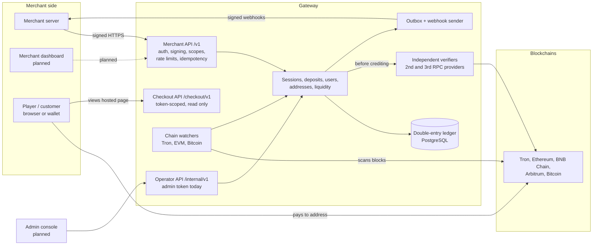
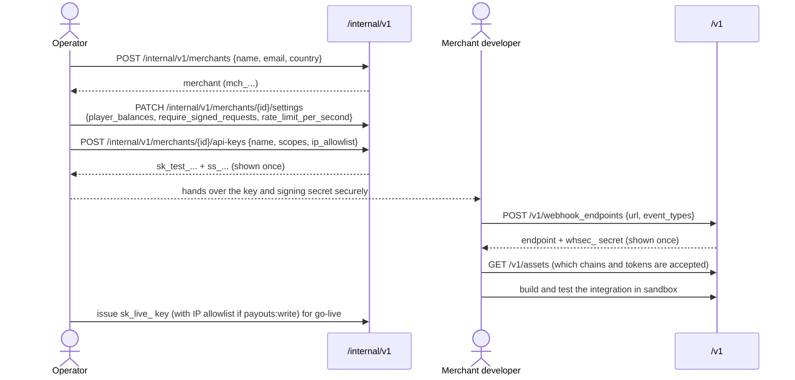
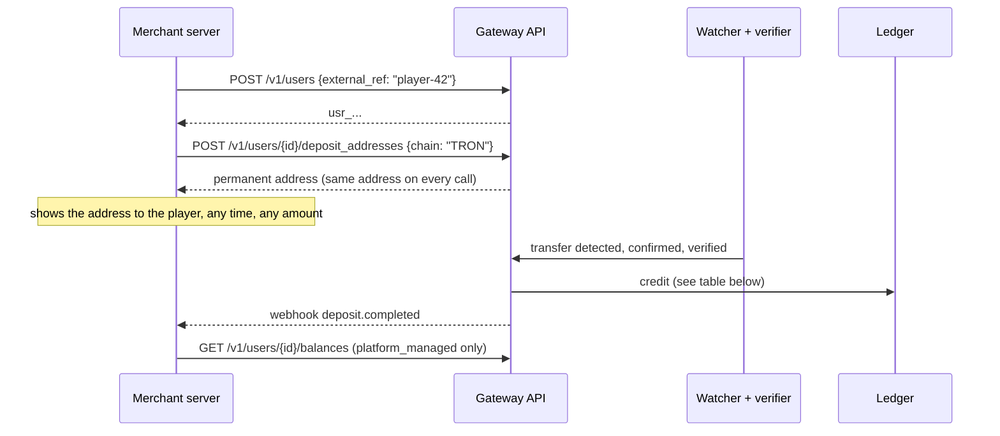
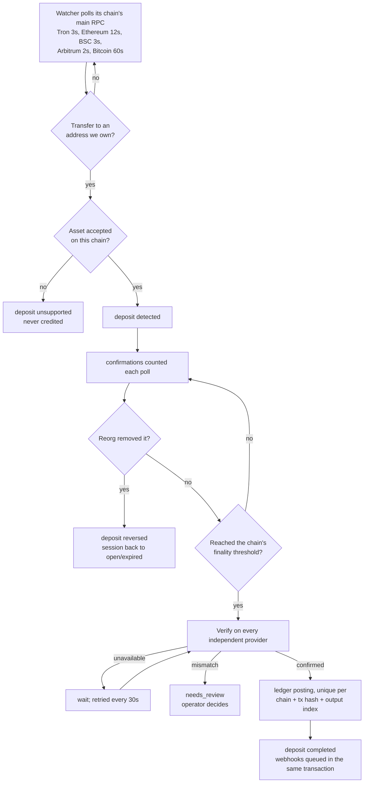
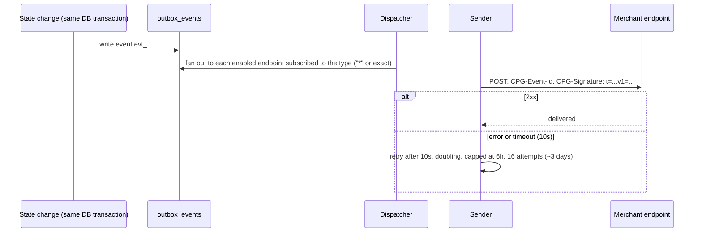
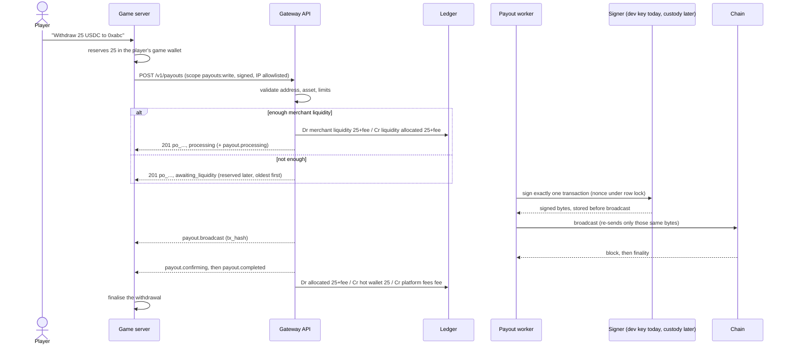

# End-to-end workflows

Status as of 2026-10-15 (code on `main` through PR #6). Sections marked **Planned** describe the agreed design;
the code does not do them yet. Cashouts (section 9) are built in PR #8, pending merge.

Contents:
1. [The system at a glance](#1-the-system-at-a-glance)
2. [Who holds what money](#2-who-holds-what-money)
3. [Merchant onboarding](#3-merchant-onboarding-live-operator-driven)
4. [Order deposit with a payment session](#4-order-deposit-with-a-payment-session-live)
5. [Deposit to a permanent player address](#5-deposit-to-a-permanent-player-address-live)
6. [Merchant liquidity pay-in](#6-merchant-liquidity-pay-in-live)
7. [What happens on the blockchain side](#7-what-happens-on-the-blockchain-side-live)
8. [Webhook delivery](#8-webhook-delivery-live)
9. [Player cashout](#9-player-cashout-built-pending-merge-in-pr-8)
10. [Merchant payout](#10-merchant-payout-planned)
11. [Reconciliation and reporting](#11-reconciliation-and-reporting-planned)
12. [Testing end to end in the sandbox](#12-testing-end-to-end-in-the-sandbox-live)

## 1. The system at a glance



All of this runs today as one Spring Boot service (`services/gateway-api`) organised by module, with PostgreSQL as
the source of truth. Background loops (chain watchers, verification retries, session expiry, webhook delivery)
run in the same service and can be switched off per instance with `JOBS_ENABLED=false`.

The rule that everything else follows: **the ledger is never credited until the blockchain has finalised the
transfer and an independent provider has confirmed it.** The browser, the player and the merchant can never mark
anything as paid.

## 2. Who holds what money

| Actor | What they are | Balance in the ledger |
|---|---|---|
| Platform | The gateway operator | Wallet accounts (deposit wallets, hot, cold, gas), fee revenue, network fee expense |
| Merchant | A business using the gateway (for example a game) | **Liquidity** (crypto that funds its players' cashouts), **liquidity allocated** (earmarked for cashouts in flight), **user obligations** (what it owes its players, platform-managed merchants only) |
| Player (user) | The merchant's end user | Available, pending and reserved balances, **only** when the merchant uses `platform_managed` player balances |
| Operator | Platform staff | None. Every action is written to the audit log |

Each merchant chooses how player balances are kept (set by an operator, `player_balances`):

| Setting | Who keeps the player's balance | Used for |
|---|---|---|
| `platform_managed` (default) | The gateway keeps a balance per player per asset | Merchants without their own wallet system |
| `merchant_managed` | The merchant's own system (for example the game's wallet). The gateway stores `player_ref` for audit only | Gaming merchants |

Liquidity rules (decided): a merchant's liquidity pays **only its own players' cashouts**, is never pooled with
other merchants, and earns nothing. Every confirmed player deposit adds to the merchant's liquidity automatically,
so the merchant only needs to top up when cashouts exceed deposits.

Amounts are exact integers in the asset's smallest unit inside the system (`NUMERIC(78,0)`), and decimal strings in
the API. Floating point is never used for money.

## 3. Merchant onboarding (Live, operator-driven)

Self-service signup and the merchant dashboard are **planned**. Today an operator onboards each merchant through
the internal API.



Steps in words:

1. Operator creates the merchant with name, email and country.
2. Operator sets the merchant's settings: `player_balances` (`merchant_managed` for games), whether test keys must
   sign requests, and the per-key rate limit.
3. Operator issues the first API key. Both secrets, the API key (`sk_test_…` / `sk_live_…`) and the signing secret
   (`ss_…`), are shown once and never again.
4. The merchant registers a webhook endpoint and stores its secret.
5. The merchant builds the integration against the sandbox (`GATEWAY_MODE=test`), using
   `POST /v1/sandbox/simulate_deposit` instead of real coins.
6. For go-live the operator issues a live key. Live keys must sign every request; a key with `payouts:write` must
   have an IP allowlist.
7. From then on the merchant can create, roll and revoke its own keys (`/v1/api_keys`, scope `keys:manage`).

## 4. Order deposit with a payment session (Live)

This is the main flow for a gaming merchant: one deposit order, bound to a player, an order ID, an amount, an
asset and a network.

```mermaid
sequenceDiagram
    actor P as Player
    participant G as Game server
    participant API as Gateway API
    participant Page as Hosted page (planned UI)
    participant W as Chain watcher
    participant V as Verifier
    participant L as Ledger
    participant WH as Webhook sender

    P->>G: "Deposit 25 USDT on Arbitrum"
    G->>API: POST /v1/payment_sessions (signed, Idempotency-Key)
    API-->>G: 201 session: ps_..., address, payment_url, expires_at
    G-->>P: redirect to payment_url (or show address + QR in game)
    P->>Page: opens page; it polls GET /checkout/v1/sessions/{id}
    P->>W: sends 25 USDT from any wallet (on chain)
    W->>API: transfer seen to the session address
    API->>API: deposit "detected", session "pending"
    API->>WH: payment_session.pending
    W->>API: confirmations grow
    API->>WH: payment_session.confirming
    W->>API: finality reached (20 blocks on Arbitrum)
    API->>V: verify the transfer on independent providers
    V-->>API: confirmed
    API->>L: Dr deposit_wallets 25 / Cr merchant liquidity 25-fee / Cr platform fees
    API->>API: deposit "completed", session "completed"
    API->>WH: payment_session.completed
    WH->>G: signed webhook
    G->>G: verify signature, dedupe on event id,<br/>credit player 25 (keyed on session id)
    G-->>WH: 2xx
```

Key rules:

- Creating a session gives it its own fresh deposit address and an unguessable checkout token. The token is in the
  URL fragment (`#t=…`), so it never reaches server logs.
- Re-sending the same `merchant_order_id` with the same details returns the existing session (`200`); different
  details return `409 order_conflict`. A lost response is always safe to retry.
- Session statuses: `open → pending → confirming → completed`, or `underpaid`, `overpaid`, `late_payment`
  (paid after expiry), `expired`, `cancelled`, `needs_review` (wrong asset, or verification disagreed). A reorg
  before finality sends the session back to `open` or `expired` and emits `payment_session.reversed`.
- `amount_received` is cumulative. An underpaid session that is topped up later moves to `completed`, so the
  merchant credits the difference.
- Sessions always fund the merchant's **liquidity**. The gateway never keeps a player balance for session payments;
  the game credits its own wallet when it gets the webhook.
- The game must never credit a player because the player returned to `return_url` or because the page said so.
- An expiry job closes unpaid sessions after `expires_at` (checked every 15 seconds).

Full integration detail: [payment-sessions.md](payment-sessions.md).

## 5. Deposit to a permanent player address (Live)

For merchants that want a reusable address per player per chain instead of one address per order.



Postings when a player deposit of amount A completes (fee F = merchant's `deposit_fee_bps`, default 0):

| Merchant setting | Ledger postings |
|---|---|
| `platform_managed` | Dr deposit_wallets A / Cr merchant liquidity A−F / Cr platform fees F, **and** Dr merchant user_obligations A / Cr user available A |
| `merchant_managed` | Dr deposit_wallets A / Cr merchant liquidity A−F / Cr platform fees F (no player balance) |

With `platform_managed`, the player is credited the full amount and the merchant bears the fee. The
`user_obligations` account lets the same coins count once in the merchant's liquidity and once as what the merchant
owes its player, without double counting.

Deposit statuses: `detected → confirming → completed`, or `unsupported` (token not accepted on that chain, or zero
amount; never credited, recorded for manual recovery), `reversed` (dropped by a reorg before finality; revives to
`detected` if re-mined), `needs_review` (verification mismatch, reorg after completion, or a re-mined transaction
that was already credited). Every transition is written to `deposit_status_history`.

## 6. Merchant liquidity pay-in (Live)

The merchant pre-funds the liquidity that will pay its players' cashouts.

1. `POST /v1/payin_addresses {chain}` returns the merchant's own permanent pay-in address on that chain.
2. The merchant sends crypto to it from its treasury.
3. The deposit goes through the same watcher, finality and verification steps as any deposit.
4. On completion: Dr deposit_wallets P / Cr merchant liquidity P. No deposit fee on pay-ins.
5. `GET /v1/liquidity` shows `available`, `allocated` and `owed_to_users` per asset.
6. `GET /v1/deposits?type=merchant_payin` lists pay-ins.

## 7. What happens on the blockchain side (Live)



- Confirmation thresholds per chain: Tron 19, Ethereum 12, BNB Smart Chain 15, Arbitrum 20, Bitcoin 2.
- Native coins come from transaction values and token transfers from `Transfer` logs (EVM) or TRC-20 events (Tron);
  Bitcoin uses UTXO outputs.
- Watchers store a cursor per chain and track block hashes, so an RPC outage resumes without gaps and a reorg rewinds
  cleanly.
- Without `INDEXER_<CHAIN>_VERIFY_RPC_URLS`, deposits wait at finality and are **never** credited.
- Addresses are derived from account-level extended public keys (`WALLET_<CHAIN>_XPUB`). No private key exists
  anywhere in the service.
- **Planned**: sweeps from deposit addresses to hot wallets, gas tanks, hot/warm/cold tiers through an MPC custody
  provider (provider not chosen yet).

## 8. Webhook delivery (Live)



- Events are written in the same database transaction as the change, so a state change and its event never diverge.
- Delivery is at least once, and events can arrive out of order. Merchants dedupe on the event `id` and read
  `status` from the payload or fetch the object.
- Signature: `HMAC-SHA256(endpoint_secret, t + "." + raw_body)`. During a secret rotation two `v1` values are sent.
- Merchants can inspect every attempt (`GET /v1/webhook_events/{id}`) and redeliver
  (`POST /v1/webhook_events/{id}/redeliver`).
- Endpoints must be absolute HTTPS URLs without credentials (plain HTTP is allowed in sandbox). In live mode a URL
  that resolves to a private, loopback or link-local address is refused at send time (SSRF guard). Redirects are not
  followed. At most 10 enabled endpoints per merchant.

## 9. Player cashout (Built, pending merge in PR #8)

Built in PR #8 for merchants with `player_balances = merchant_managed`, on Ethereum, BNB Smart Chain and Arbitrum.
Live signing waits for the custody provider: today the only signer is a development key that live mode refuses.
Full guide: [payouts.md](payouts.md).



Statuses: `awaiting_liquidity`, `processing`, `broadcast`, `confirming`, `completed`, plus `failed` and `cancelled`
(liquidity refunded, the game returns the amount to the player) and `needs_review` (outcome uncertain; still
tracked, and it ends in `completed` or `failed`). Every change sends `payout.<status>`.

How it avoids paying twice:

- Re-sending the same `merchant_payout_id` with the same details returns the existing payout; different details
  return `409 payout_conflict`.
- One signed transaction per payout, stored before broadcast. Retries and restarts only re-send those bytes.
- A transaction not final within 30 minutes (`PAYOUTS_STUCK_AFTER`), or whose nonce was used by something else, goes
  to `needs_review`, never to a second payout. An operator can mark it `failed` only when the chain proves the
  transaction can never be mined; the gateway checks that proof itself.
- Cancel is allowed only before signing (`awaiting_liquidity` or `processing`).
- Network gas is paid by the platform in the chain's native coin. Payouts wait instead of signing while gas is above
  the configured cap.

Merchant controls set by operators: `payout_fee_bps` (on top of the amount) and per-asset payout limits
(`per_payout`, rolling `per_day`).

Not built yet: cashouts for `platform_managed` merchants (which also reserve the player's own balance,
Dr user available / Cr user reserved), Tron and Bitcoin payouts, the custody-provider signer, sweeps, and a
`liquidity.low` webhook.

## 10. Merchant payout (Planned)

The merchant withdraws its own money (unallocated liquidity it no longer needs, or earnings) to a whitelisted
address. It has its own table, statuses, ledger accounts and approval rules, separate from player cashouts: payable
balance check, whitelisted destination with a 24 to 48 hour cool-down after changes, two-person approval above a
threshold, then the same signing and on-chain tracking as cashouts. Liquidity already allocated to cashouts in
flight cannot be withdrawn. See [payment-flows.md](payment-flows.md) §6.

## 11. Reconciliation and reporting (Planned)

- Daily per merchant and asset: confirmed on-chain deposits against ledger credits, payouts against ledger debits,
  liquidity and fee balances. Differences become reconciliation items and alerts.
- Platform level: ledger wallet accounts against on-chain wallet balances (proof of solvency). A shortfall pauses
  payouts and pages on-call.
- Merchant reports: transactions CSV export and daily reconciliation API.

What exists today to support this: the append-only ledger (balanced per asset, checked at commit), append-only
status histories, the audit log, outbox events, and Prometheus metrics including chain scan lag.

## 12. Testing end to end in the sandbox (Live)

1. Run with `GATEWAY_MODE=test` and use an `sk_test_` key (signing optional unless `require_signed_requests`).
2. Create a payment session (or a player deposit address).
3. Pay it without any chain:
   `POST /v1/sandbox/simulate_deposit {"address": "<address>", "asset": "USDT_ARBITRUM", "amount": "25"}`.
4. The deposit completes immediately, the session moves to `completed`, the ledger posts and webhooks fire exactly as
   in production.
5. Check the result with `GET /v1/payment_sessions/{id}`, `GET /v1/webhook_events` and `GET /v1/liquidity`.

The sandbox endpoint returns `404` in live mode.
