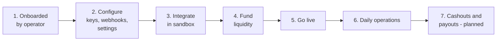

# Merchant workflow

Status as of 2026-10-14. The merchant **API** is live (see [api-reference.md](api-reference.md)). The merchant
**dashboard** is planned (Next.js, React, TypeScript, Tailwind, shadcn/ui); section 4 describes how it is meant to
work so it can be designed and built against the existing API.

## 1. The merchant journey

| Step | What the merchant does | How today | In the planned dashboard |
|---|---|---|---|
| 1. Onboarding | Gets an account | Operator creates it (`POST /internal/v1/merchants`) | Self-service signup, email verification, mandatory 2FA, optional KYB if switched on for the merchant |
| 2. Configure | API keys, webhook endpoint, player-balance mode | First key from the operator, then `/v1/api_keys`, `/v1/webhook_endpoints`; settings via operator | Developers page, Webhooks page, Settings page |
| 3. Integrate | Builds deposit flow against the sandbox | `sk_test_` key, `POST /v1/sandbox/simulate_deposit` | Sandbox toggle and "simulate payment" button |
| 4. Fund liquidity | Pre-funds what pays its players' cashouts | `POST /v1/payin_addresses`, send crypto, check `GET /v1/liquidity` | Liquidity page with pay-in address and QR |
| 5. Go live | Live key, signed requests, IP allowlist for payouts | Operator issues `sk_live_` key | Live/test switch, go-live checklist |
| 6. Operate | Watches deposits, sessions, webhooks, balances | `GET` endpoints and webhook log | Home, Payments, Players, Webhooks pages |
| 7. Cash out | Pays players and withdraws its own funds | Not built (Phase 2c) | Cashouts and Payouts pages |

## 2. Integrating deposits (live)

A merchant can take deposits in two ways. Most gaming merchants use payment sessions.

### Option A: payment session per order (recommended for games)

1. Player asks to deposit an amount in the game.
2. Game server calls `POST /v1/payment_sessions` with `player_ref`, `merchant_order_id`, `network`, `asset`,
   `amount`.
3. Game shows `payment_url` (redirect or iframe) or shows `address` and `amount` in its own UI.
4. Player pays from any wallet.
5. Game receives `payment_session.completed` (or `underpaid`, `overpaid`, `late_payment`) by webhook, verifies the
   signature, dedupes on event `id`, and credits the player `amount_received` keyed on the session `id`.
6. If a webhook seems missing: `GET /v1/payment_sessions?merchant_order_id=…`, or check
   `GET /v1/webhook_events/{id}` and redeliver.

Set `player_balances = merchant_managed` (ask an operator) so the gateway does not also keep a balance per player.

### Option B: permanent address per player

1. `POST /v1/users {external_ref}` once per player.
2. `POST /v1/users/{id}/deposit_addresses {chain}` once per player per chain; show the address any time.
3. Credit on `deposit.completed`.
4. With `platform_managed`, the gateway also keeps the player's balance: `GET /v1/users/{id}/balances`.

### Rules every merchant integration must follow

- Call the API only from your servers. Never put keys in a browser, app or game client.
- Store `sk_…`, `ss_…` and `whsec_…` secrets in a secret manager. They are shown once.
- Sign every request (required on live keys). Use a fresh nonce and timestamp on every retry, and the same
  `Idempotency-Key`.
- Credit a player only from a verified webhook or an API read, never from the browser or `return_url`.
- Make crediting idempotent per session or deposit `id`.
- Answer webhooks with 2xx quickly; do slow work afterwards.

## 3. Daily operations (live via API)

| Task | API |
|---|---|
| See today's deposits | `GET /v1/deposits?status=completed`, `GET /v1/payment_sessions?status=completed` |
| Look up one player's activity | `GET /v1/users?external_ref=…`, `GET /v1/deposits?user_id=…`, `GET /v1/payment_sessions?player_ref=…` |
| Investigate a disputed deposit | `GET /v1/payment_sessions/{id}` (its `payments` list each tx hash), `GET /v1/deposits/{id}` |
| Sessions needing attention | `GET /v1/payment_sessions?status=needs_review` / `underpaid` / `late_payment` |
| Check liquidity | `GET /v1/liquidity` |
| Webhook failures | `GET /v1/webhook_events`, `GET /v1/webhook_events/{id}`, `POST /v1/webhook_events/{id}/redeliver` |
| Rotate a webhook secret | `POST /v1/webhook_endpoints/{id}/rotate_secret {"overlap_hours": 24}` |
| Rotate an API key | `POST /v1/api_keys/{id}/roll`, deploy, confirm `last_used_at` of the old key stops, then let it expire or revoke |
| Revoke a leaked key | `POST /v1/api_keys/{id}/revoke` (immediate) |

`needs_review` sessions and deposits are handled by platform operations, who contact the merchant. A wrong-asset or
unsupported-token deposit is never credited automatically.

## 4. Merchant dashboard (planned)

A web app for merchant staff, built on the same `/v1` API through a dashboard session (login with 2FA, team roles)
instead of API keys. Nothing here is built yet.

### 4.1 Team roles

| Role | Can |
|---|---|
| Owner | Everything, including team, billing and payout addresses |
| Admin | Everything except ownership transfer |
| Developer | API keys, webhooks, sandbox, logs; read payments |
| Finance | Payments, liquidity, cashouts, payouts, reports; request payouts (approval rules apply) |
| Support | Look up players, sessions and deposits; read only |
| Read-only | View everything, change nothing |

Sensitive actions (new payout address, new key with `payouts:write`, team changes) require re-entering 2FA and are
written to the audit log.

### 4.2 Pages

| Page | Shows | Actions | API behind it |
|---|---|---|---|
| Home | Deposits today, volume per asset, open and `needs_review` sessions, liquidity per asset with low-balance warning, webhook failure rate | Jump to items needing attention | `/v1/payment_sessions`, `/v1/deposits`, `/v1/liquidity`, `/v1/webhook_events` (live) |
| Payments | Sessions and deposits with filters (status, network, asset, player, order ID, date), detail drawer with tx hashes and explorer links, status history | Cancel an open session, copy payment link, export CSV (planned API) | `/v1/payment_sessions`, `/v1/deposits` (live) |
| Players | Players by `external_ref`, their addresses, deposits and (platform-managed) balances | Create player, show address | `/v1/users`, `/v1/users/{id}/…` (live) |
| Liquidity | Available, allocated and owed per asset; pay-in addresses with QR; pay-in history; low-balance alert threshold | Get pay-in address, set alert threshold (planned) | `/v1/liquidity`, `/v1/payin_addresses`, `/v1/deposits?type=merchant_payin` (live) |
| Cashouts | Player cashouts with status, tx hash, `awaiting_liquidity` queue | Cancel before signing | `/v1/payouts` (planned, Phase 2c) |
| Payouts | Merchant's own withdrawals, whitelisted addresses with cool-down | Request payout, add address (2FA, cool-down, approvals) | Planned |
| Webhooks | Endpoints, event log, every delivery attempt with status code and duration | Add, disable, rotate secret, redeliver, send test event (planned) | `/v1/webhook_endpoints`, `/v1/webhook_events` (live) |
| Developers | API keys with scopes, allowlist, last used; request signing guide; OpenAPI docs | Create, roll, revoke keys | `/v1/api_keys` (live) |
| Reports | Transactions, fees, daily reconciliation | Download CSV | Planned (Phase 2e) |
| Settings | Business profile, branding for the hosted page, player-balance mode (read only), team | Edit profile and branding, invite team | Planned |
| Sandbox | Test-mode switch | Simulate a payment to any session or address | `/v1/sandbox/simulate_deposit` (live) |

### 4.3 Key screens in words

**Payment detail.** Header with status badge, amount expected and received, network and asset. Timeline built from
the status history (opened, transfer seen, each confirmation milestone, verified, completed). Each on-chain payment
with tx hash, confirmations and block explorer link. Webhooks sent for this session with delivery status and a
redeliver button. Metadata as JSON.

**Liquidity.** One card per asset: available, allocated, owed to users, and a bar showing available against the
alert threshold. A "Top up" button opens the pay-in address with QR and the chain warning ("send only USDT on
Arbitrum to this address").

**Webhook delivery log.** Table of events newest first with type and overall delivery result. Expanding an event
shows each endpoint and every attempt (time, HTTP status, error, duration), the next retry time, and a redeliver
button.

## 5. Hosted payment page (API live, page planned)

What the player sees when the merchant uses `payment_url`:

1. Merchant logo and name (branding planned), amount and asset, network name with a warning to use only that network.
2. Address with copy button and QR code; for EVM tokens, a wallet deep link (WalletConnect planned).
3. Countdown to `expires_at`.
4. Live status from `GET /checkout/v1/sessions/{id}`: waiting, payment seen, confirmations n of m, completed,
   underpaid (shows what is still due), expired.
5. "Back to merchant" link to `return_url`.

The page only displays. It cannot mark a payment as paid; only the chain watcher plus independent verification can.
